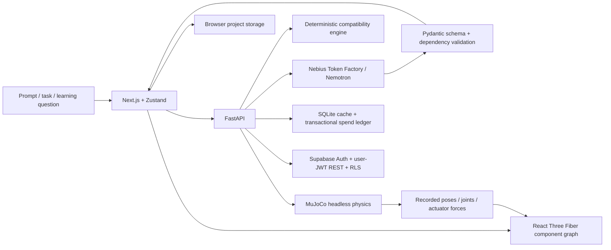

# Architecture

## Shared specification

`RobotSpecification` contains structural, actuator, sensor, power, compute, and controller components. Geometry uses full SI dimensions and Y-up frontend coordinates. A dependency DAG defines assembly order. Joint references and degrees of freedom must agree. Backend checks reject duplicate components, cycles, unknown dependencies, nonfinite geometry, and oversized geometry. Procedural primitives are intentionally constrained; unfamiliar mechanisms can be represented conceptually without claiming supported physics.

Robot/project IDs connect task assumptions, selected hardware, experiments, quiz attempts, and flashcard review. Switching designs clears incompatible downstream state. Browser storage keeps up to eight projects and twenty recent runs per active project. A cloud project is a validated JSON document in Supabase, owned by the signed-in user.

## Simulation boundary

The supported adapter accepts a box chassis called `chassis` and exactly four cylindrical, lateral-hinge wheel actuators. It maps the generated component coordinates into MuJoCo's Z-up frame. XML is constructed with escaped ElementTree attributes, not arbitrary model-generated XML. Other components contribute fixed collision geometry and mass. Wheel velocity setpoints ramp at 4 rad/s² to the requested bounded 0–8 rad/s target (default 4), with the existing force limits. Runs record actual design mass and the setpoint used. The improvement workflow retains predictions and previous experiment results. Flat-plane contacts, gravity, and controller forces are actual solver output.

The adapter validates support structurally; an AI-provided capability label alone is insufficient. Unsupported designs receive HTTP 422. The drive experiment does not run navigation, interpret images, or satisfy an arbitrary natural-language mission. Contacts include normal wheel-floor contact. `task_completed` is null and `hardware_benchmarked` is false. Browser playback uses actual position, quaternion, joint, force, and contact samples, including time zero and the final state. Positions are returned in Y-up XYZ; quaternions remain MuJoCo Z-up WXYZ and are converted for rendering. Responses explicitly report backend CPU execution, integration timestep, and successful solver completion.

`PlaybackClock` runs outside the WebGL tree and maps elapsed wall time to recorded timestamps. Slow rendering can skip displayed samples without stretching the experiment or inventing poses. Playback, scrubbing, Reset, and Replay never dispatch another solve. Hidden tabs pause playback. The shared simulation action admits only one solve at a time, validates returned states, preserves prior evidence after failure, and rejects a result if its design changed during execution. The studio distinguishes synchronous backend solving from subsequent playback of the recorded states.

The studio uses a dedicated center viewport, a mounting hierarchy, a properties/learning panel, and a persistent simulation dock. Part and camera state subscriptions exclude per-sample React updates; Three.js reads the current pose directly during rendering. Inspection translations use a separate bounded visual-offset map and are not design edits. Starting simulation clears them; they never alter the validated specification, collision model, or saved engineering geometry. Backend-validated geometry editing is not implemented by these tools.

Rendering diagnostics read the active WebGL context's renderer/version and optional debug-renderer extension. Software renderer strings are identified explicitly; hidden strings remain unknown. Continuous FPS samples actual frame intervals; on-demand reduced-motion mode reports that continuous FPS is not sampled. These measurements are independent of CPU solver timing and Nebius cloud model inference. The application has no local RTX, CUDA physics, or Isaac execution adapter.

## Inference and cost

Only backend code uses the API credential. The base URL is restricted to Token Factory. Model discovery filters the authenticated catalog for Nemotron. Workflows carry the current robot and relevant task/experiment context. Schema failures return explicit errors. Geometry, numerical checks, physics, and hardware eligibility never rely on model arithmetic.

Before each paid request, the ledger reserves a conservative amount based on configured verified rates, UTF-8 message bytes as an input-token bound plus overhead, and the maximum output tokens. SQLite `BEGIN IMMEDIATE` makes reservations transactional against pending reservations plus recorded charges, with a hard ceiling of $1 (or a lower configured limit). Valid nonnegative integer provider usage replaces reservations even when the output is subsequently rejected. Invalid or absent usage retains the reservation. The provider response must identify the requested model and finish normally before application validation. Unknown charges remain reserved. No automatic retries multiply uncertain charges. This is an estimated cost admission guard, dependent on configured token prices and correct provider usage. It cannot see provider credit balance, prevent provider billing anomalies, or control spending by other applications. Separate replicas with separate SQLite files do not share a budget.

Generation passes the Pydantic schema as `response_format.json_schema`. Nemotron 3 Super generation disables extended thinking using the documented reasoning/extra-parameter fields, preserving the fixed 2,048-token output budget for structured output. See the public provider schema at https://api.tokenfactory.nebius.com/openapi.json. No automatic paid retries occur.

The ledger adds `response_model`, `completed_at`, and `validated_at` without replacing old rows. Verification requires a successful response from the selected model plus application-schema validation. Only the latest recorded success for the configured model is exposed, with an explicit historical-evidence label. Unknown/legacy records and cache hits cannot create fresh verification.

## Integration classifications

- MuJoCo: actually integrated and tested.
- R3F / Three.js / Zustand / Next.js / FastAPI: actually integrated and locally tested.
- NVIDIA Nemotron through Nebius: authenticated catalog and five distinct real generated designs verified in the core workflow milestone; browser regression uses explicitly recorded real-response replays without new paid inference. Other AI workflows and larger designs still require live regression checks.
- Supabase: implemented auth/storage adapter and SQL migration; live service unverified.
- Vera Rubin / Grace / Jetson software / CUDA / TensorRT / Isaac ROS / Cosmos / GR00T: educational context, not execution integrations.
- Isaac Sim / Isaac Lab and GPU benchmarking: planned, not installed or executed.

No claims are made that this app executes on NVIDIA GPUs, Jetson, Vera Rubin, or Nebius AI Cloud. Current physics runs on the development CPU.

## ARISE cinematic state

A separate Zustand timeline samples deterministic sphere/component poses, avoiding accumulated drift when scrubbing backward. Assembly follows the shared dependency graph. The original robot lab, controls, and physics playback remain in the same R3F scene. Client media preferences use a server-stable snapshot before applying reduced motion. A backend visual-development guard blocks provider calls independently of the browser fixture helper. See [the milestone report](arise-milestone.md) for source checks, scene scope, and remaining limits.
