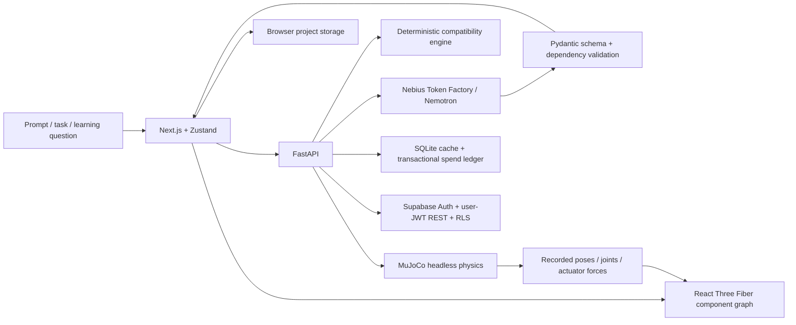

# Architecture

## Shared specification

`RobotSpecification` contains structural, actuator, sensor, power, compute, and controller components. Geometry uses full SI dimensions and Y-up frontend coordinates. A dependency DAG defines assembly order. Joint references and degrees of freedom must agree. Backend checks reject duplicate components, cycles, unknown dependencies, nonfinite geometry, and oversized geometry. Procedural primitives are intentionally constrained; unfamiliar mechanisms can be represented conceptually without claiming supported physics.

Robot/project IDs connect task assumptions, selected hardware, experiments, quiz attempts, and flashcard review. Switching designs clears incompatible downstream state. Browser storage keeps up to eight projects and twenty recent runs per active project. A cloud project is a validated JSON document in Supabase, owned by the signed-in user.

## Simulation boundary

The supported adapter accepts a box chassis called `chassis` and exactly four cylindrical, lateral-hinge wheel actuators. It maps the generated component coordinates into MuJoCo's Z-up frame. XML is constructed with escaped ElementTree attributes, not arbitrary model-generated XML. Other components contribute fixed collision geometry and mass. Wheel velocity setpoints ramp to 4 rad/s with force limits. Flat-plane contacts, gravity, and controller forces are actual solver output.

The adapter validates support structurally; an AI-provided capability label alone is insufficient. Unsupported designs receive HTTP 422. The drive experiment does not run navigation, interpret images, or satisfy an arbitrary natural-language mission. Contacts include normal wheel-floor contact. `task_completed` is null and `hardware_benchmarked` is false. Browser playback uses actual position, quaternion, joint, force, and contact samples.

## Inference and cost

Only backend code uses the API credential. The base URL is restricted to Token Factory. Model discovery filters the authenticated catalog for Nemotron. Workflows carry the current robot and relevant task/experiment context. Schema failures return explicit errors. Geometry, numerical checks, physics, and hardware eligibility never rely on model arithmetic.

Before each paid request, the ledger reserves a conservative amount based on configured verified rates, UTF-8 message bytes as an input-token bound plus overhead, and the maximum output tokens. SQLite `BEGIN IMMEDIATE` makes the single-instance limit transactional. Actual provider usage replaces reservations when returned. Unknown charges remain reserved. No automatic retries multiply uncertain charges. This control cannot see provider credit balance or spending by other applications.

## Integration classifications

- MuJoCo: actually integrated and tested.
- R3F / Three.js / Zustand / Next.js / FastAPI: actually integrated and locally tested.
- NVIDIA Nemotron through Nebius: implemented adapter; live catalog and inference unverified without credentials/network access.
- Supabase: implemented auth/storage adapter and SQL migration; live service unverified.
- Vera Rubin / Grace / Jetson software / CUDA / TensorRT / Isaac ROS / Cosmos / GR00T: educational context, not execution integrations.
- Isaac Sim / Isaac Lab and GPU benchmarking: planned, not installed or executed.

No claims are made that this app executes on NVIDIA GPUs, Jetson, Vera Rubin, or Nebius AI Cloud. Current physics runs on the development CPU.
